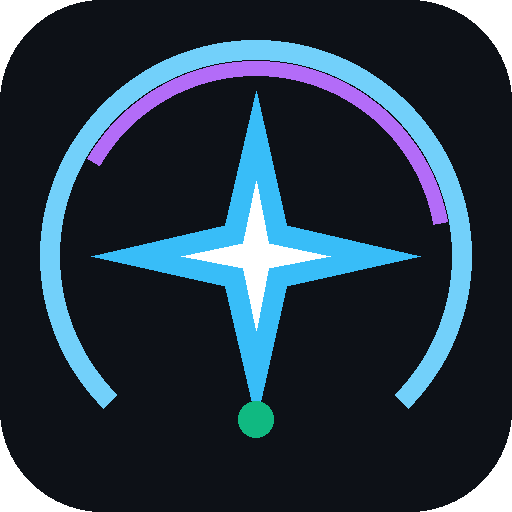

# Antigravity AI Usage Tracker for Elgato Stream Deck

<p align="center">
  
</p>

<p align="center">
  <strong>Real-time AI Quota, Rate Limit, and Reset Monitor for Elgato Stream Deck & Stream Deck +</strong>
</p>

---

## 🌟 Overview

**Antigravity AI Tracker** is a professional Elgato Stream Deck plugin built with the official `@elgato/streamdeck` SDK v3. It tracks and visualizes your live Google Antigravity AI quotas and countdowns directly on your Stream Deck buttons and dials so you never get interrupted by rate limits mid-task.

### What it tracks:
1. **Gemini Weekly Limit**: Remaining percentage and days/hours until weekly renewal.
2. **Gemini 5-Hour Rolling Limit**: Live percentage and countdown for your active 5-hour rolling session window.
3. **Claude & GPT Models**: Quota availability for pooled Anthropic (Claude 3.7 / 3.5 Sonnet & Opus) and OpenAI (GPT-OSS / GPT) models, supporting both 5-hour and weekly views.
4. **Gemini 4 Argon Limit**: Dedicated tracker for Google's flagship reasoning frontier model (`gemini-4-argon`) weekly quota.
5. **Multi-Metric Cycle Key**: An all-in-one button that rotates through all 4 quotas on press or dial rotation, or displays the most critical (lowest) remaining quota.

---

## 🚀 Key Features

- **⚡ Zero-Token Local Probe**: Directly queries the local Antigravity Language Server Connect RPC endpoint on `127.0.0.1`. It reads your live quota with **absolute zero token consumption**!
- **🎨 Dynamic High-DPI Vector Gauges**: Renders custom crisp vector SVGs at 144×144 resolution with smooth circular ring gauges, horizontal progress bars, or bold minimal typography.
- **🚥 Color-Coded Alert Thresholds**:
  - 🟢 **Healthy (> 50%)**: Bright Emerald / Gemini Cyan
  - 🟡 **Warning (20% – 50%)**: Amber warning
  - 🔴 **Critical (< 20%)**: Crimson alert
- **⏳ Smart Reset Timers**: Automatically calculates and formats countdowns (e.g. `⏳ 2h 15m`, `⏳ 4d 18h`, `< 1m`, or `READY`).
- **🎛️ Stream Deck + Support**: Full support for Stream Deck + dials and touchscreen strip with real-time value bars and metric scrubbing.
- **🔄 Instant Manual Sync**: Tap any key to trigger an instant live refresh with visual confirmation feedback.
- **🧪 Built-In Demo Mode**: Includes an offline demo mode with simulated data so you can test layouts and styling before launching Antigravity.

---

## 📦 Installation

### Method 1: Ready-to-Use Package (Easiest)
1. Download `dist/com.mjwitz.gemini-tracker.streamDeckPlugin` from this repository or the Releases section.
2. Double-click the file on Windows or macOS.
3. Elgato Stream Deck will prompt: *"Do you want to install the 'Antigravity AI Tracker' plugin?"* Click **Install**.
4. The plugin will appear in the Stream Deck actions list under **Antigravity AI Tracker**.

### Method 2: Development Installation
```bash
# Clone the repository
git clone https://github.com/Mjwitz/StreamDeckGeminiTracker.git
cd StreamDeckGeminiTracker

# Install dependencies
npm install

# Build and package the plugin
npm run build
npm run validate
npm run pack

# Link to Stream Deck app (for live development)
npx streamdeck link com.mjwitz.gemini-tracker.sdPlugin
```

---

## 🎛️ Available Actions

| Action | Description | Key Press Behavior | Dial Rotation |
| :--- | :--- | :--- | :--- |
| **Gemini Weekly Limit** | Monitors weekly Gemini quota pool | Triggers immediate sync | Toggles display view |
| **Gemini 5-Hour Limit** | Monitors active 5-hour rolling session | Triggers immediate sync | Toggles display view |
| **Claude & GPT Limit** | Monitors pooled Claude/GPT usage | Triggers immediate sync | Switches between 5h and Weekly |
| **Gemini 4 Argon Limit**| Monitors dedicated Gemini 4 Argon reasoning quota | Triggers immediate sync | Toggles display view |
| **Multi-Metric Cycle** | Cycles through all metrics on a single key | Steps to next model | Steps to next/previous model |

---

## ⚙️ Configuration & Settings

Click any action on your Stream Deck canvas to open the **Property Inspector**:

- **Display Style**:
  - `Radial Ring Gauge`: Circular progress arc with large centered percentage and bottom countdown badge.
  - `Linear Bar Meter`: Bold percentage with a sleek horizontal bar meter.
  - `Compact / Minimal`: Bold high-contrast typography.
- **Data Source**:
  - `Auto-Detect Local (Zero-Config)`: Automatically detects your running Antigravity IDE, desktop app, or `agy` CLI process and connects to its local RPC server.
  - `Google Cloud Code API`: Connects to `https://daily-cloudcode-pa.googleapis.com` or `https://cloudcode-pa.googleapis.com` using OAuth bearer credentials.
  - `Demo Mode`: Displays realistic sample quota for testing keys and themes.
- **Refresh Interval**: Choose between 15s, 30s, 60s (recommended), 2m, or 5m.
- **Warning & Critical Thresholds**: Adjust the percentage at which keys turn amber or red.

---

## 🔍 How Local Detection Works

When Antigravity runs (via the Desktop IDE or `agy` CLI), it spawns an internal language server process:
1. The plugin discovers the process and reads the command-line arguments:
   - `--csrf_token <token>`
   - `--extension_server_port <port>`
2. It sends an HTTP POST request to the local Connect RPC endpoint:
   ```http
   POST http://127.0.0.1:<port>/exa.language_server_pb.LanguageServerService/RetrieveUserQuotaSummary
   Headers:
     X-Codeium-Csrf-Token: <token>
     Connect-Protocol-Version: 1
     Content-Type: application/json
   Body: {}
   ```
3. It parses the resulting quota buckets (`gemini-5h`, `gemini-weekly`, `3p-5h`, `3p-weekly`, and `gemini-argon-wtu-weekly`) and immediately updates the Stream Deck displays with zero latency.

---

## 🛠️ Project Structure

```
StreamDeckGeminiTracker/
├── com.mjwitz.gemini-tracker.sdPlugin/    # Stream Deck plugin bundle
│   ├── manifest.json                     # Plugin contract and action metadata
│   ├── bin/
│   │   ├── plugin.js                     # Compiled Rollup JS bundle
│   │   └── package.json                  # ES module marker
│   ├── ui/
│   │   └── inspector.html                # Property Inspector HTML settings UI
│   └── imgs/                             # 20x20, 28x28, 72x72, 144x144, 288x288, 512x512 icons
├── src/
│   ├── plugin.ts                         # Plugin entry point
│   ├── types.ts                          # Quota and settings interfaces
│   ├── services/
│   │   ├── quota-service.ts              # Local discovery & Cloud Code PA API
│   │   ├── image-generator.ts            # Dynamic SVG renderer
│   │   └── time-utils.ts                 # Countdown calculator
│   └── actions/
│       ├── base-quota-action.ts          # Core action lifecycle & polling
│       ├── weekly-action.ts              # Gemini Weekly Limit
│       ├── five-hour-action.ts           # Gemini 5-Hour Limit
│       ├── claude-gpt-action.ts          # Claude & GPT Limit
│       ├── gemini-argon-action.ts        # Gemini 4 Argon Limit
│       └── cycle-action.ts               # Multi-metric cycle action
├── test/
│   └── plugin.test.ts                    # Automated unit tests
├── dist/
│   └── com.mjwitz.gemini-tracker.streamDeckPlugin  # Packaged distributable installer
├── rollup.config.mjs                     # Rollup configuration
├── tsconfig.json                         # TypeScript compiler configuration
└── package.json                          # NPM package metadata and scripts
```

---

## 🧪 Testing

Run the automated test suite with:
```bash
npm test
```

---

## 📄 License

MIT License. Designed for the Google Antigravity developer community.
